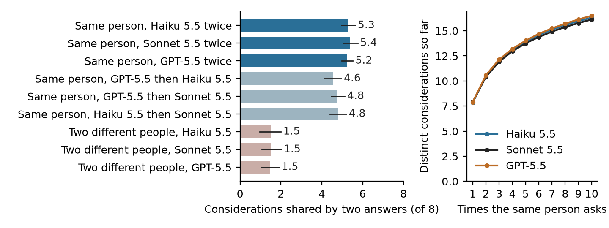

# 1. Introduction

People now ask language models what to think about before accepting a job, signing a lease or lending money to a relative. The sprint's prompt for epistemic products asks whether such a briefing "surface[s] the considerations that actually matter," and adds: how would you know? The second question is the hard one. Nearly everything a current model writes about a decision is relevant, so relevance does not separate a good briefing from a poor one, and a list can be made more varied by leaving out what matters most.

This project began as a study of variety (do all askers get the same list, and can a prompt widen it?) and ran into that problem: we could count new considerations but not say whether they mattered. So we added a measurement with a ground truth. A short description of a decision leaves facts out, and some of them would change the answer. If the roof needs replacing this year for $28,000, do not make the offer; if it has five years left, do. A briefing that surfaces what matters should raise the missing facts that would change the decision, more often than it raises missing facts that would not. People are poor at noticing what a list leaves out (Fischhoff et al., 1978), so they are unlikely to supply these themselves.

Our contributions are a way to score a briefing against what matters (missing-fact probes whose status is measured by forced choice, and one contrast named in advance); a result on three current models (Section 4.1); a check on six prompts for variety (4.2); and a description of how much the lists repeat (4.3).

# 2. Related Work

**Shared models, shared outcomes.** Kleinberg and Raghavan (2021) show that when many decision-makers rely on one algorithm, overall decision quality can fall even if it is more accurate for each of them, and Bommasani et al. (2022) that systems sharing components can fail the same individuals repeatedly. Goel et al. (2025) find that language models' mistakes grow more alike with capability, and Jiang et al. (2025) that models give similar answers to open-ended questions, within and across models. Section 4.3 measures this sameness in decision advice.

**Prompting for diversity.** Methods such as verbalized sampling (Zhang et al., 2025) and chain-of-thought prompting (Meincke et al., 2024) are scored on diversity. Section 4.2 scores six such prompts on whether they raise what matters.

**Asking for what is missing.** QuestBench (Li et al., 2025) finds that models often cannot identify the one question needed to solve an underspecified reasoning problem, even when they can solve the fully specified version. ClarifyMT-Bench (Luo et al., 2025) reports that models in dialogue tend to answer before clarifying. Those tasks have a known missing variable and a correct answer. Ours has neither, so we measure which missing facts matter and ask whether an unprompted list reaches them.

# 3. Methods

**Decisions.** Sixteen vignettes of three or four sentences: 8 decision types (job offer, lease, first home, part-time graduate school, lending money to family, care for an aging parent, going freelance, moving for a partner's job), each with two people who differ in age, money and dependents, and each posing a choice between two courses of action. Every prompt asks, "What should this person weigh in making this decision?" and requires a fixed number of one-sentence considerations.

**Prompts.** *Plain*: the vignette and the question, 8 items. Six prompts meant to widen the list, also 8 items: *think first, be diverse* (non-obvious considerations from different angles, after working it through in a notes field); *verbalized sampling* (Zhang et al.); *"What else?"*, a second turn after a plain answer asking for 8 more; *random word*, think-first plus a random noun; a *property-substitution* prompt (name a few properties of the situation, change each, see what moves, then answer); and the same with three randomly drawn dimension names. Property substitution is one step of a practice the author uses, taken from ideonomy (Gunkel; Kind); this is not a test of that practice. We later added *plain, 16 items*. Appendix B gives the wording.

**Models and samples.** All prompts ran on Claude Haiku 5.5, ten samples per vignette. The plain prompt also ran on Claude Sonnet 5.5 and GPT-5.5. Extended reasoning was off and sampling settings were the API defaults. This gave [n.answers=1,600] answers and no refusals. The widening prompts ran on Haiku because, in a pilot, Sonnet 5.5 refused the prompts that ask it to write out its reasoning, which we did not work around.

**Missing-fact probes.** GPT-5.5 was shown each vignette alone and asked for six things it does not say that an adviser might want to know: a question and two plausible answers, each a sentence that could be added to the vignette as a fact. It was asked for some facts that would change the choice and some that would not, and for some about the shape of the decision (is there a third option, is the deadline fixed). The author edited the list without looking at any generated answer and dropped a few, leaving [probe.n=94]. The probes and the analysis plan were committed before any answer was scored (Appendix C).

**Which facts are decisive.** We did not take the drafter's word. For each probe, each of the three models made a forced choice between the vignette's two options with answer A added to the vignette, and again with answer B, ten times each, with the order of the options randomized ([probe.check.calls=6,120] choices, including the vignette with no fact added). A probe's shift for a model is the absolute difference, between the two answers, in the share choosing a given option. A probe is *decisive* if the shift is at least 0.5 for at least two of the three models, *inert* if it is at most 0.1 for all three, and otherwise *middle*. This gave [probe.n.decisive=22] decisive, [probe.n.inert=39] inert and [probe.n.middle=33] middle probes. The drafter's own guesses were weak: of [probe.drafter.yes=65] facts it expected to change the choice, [probe.drafter.yes.decisive=21] were decisive and [probe.drafter.yes.inert=25] were inert.

**Does a briefing raise the fact?** A judge (Sonnet 5.5) saw the vignette, one answer's list and that vignette's probe questions, and marked each question *asks* (an item tells the person to find this out), *mentions* (an item raises the same matter without saying to find it out) or *absent*. It was told the item must concern the same specific unknown, not just the same topic. It never saw the prompt, the model, the probe's two answers or its status. A probe is *raised* if the label is asks or mentions. All [probe.judged.answers=1,760] lists were judged ([probe.judged.pairs=10,340] list-question pairs).

**The contrast, named in advance.** The share of decisive probes raised minus the share of inert probes raised, on the plain prompt, pooled over the three models. Everything else in Section 4 is exploratory.

**Controls.** (a) *Fact stated:* for each decisive or inert probe we added each of its answers in turn to the vignette and collected plain answers from each model ([probe.stated.n=732] answers); the judge, shown the original vignette, should find the matter raised. (b) *Foreign probes:* the judge rated lists against probes written for a different decision type ([probe.foreign.n=1,800] pairs); it should find almost nothing. This is an easy negative and does not test near misses on the same topic. (c) *Hand labels:* the author labeled 80 list-question pairs blind to the judge and before seeing any result (Appendix D).

**Coding considerations.** For Section 4.3, Sonnet 5.5 built a codebook of distinct considerations for each decision type ([codebook.min=31] to [codebook.max=47] codes) and sorted every sentence under one code without seeing the prompt or model. A consideration is *obvious* for a vignette if it appears in at least half of Haiku's plain answers to it (leaving out the answer being scored), and *new* if it is not obvious and a judge rated it relevant. A further judge marked each as resting on a detail the vignette states or brought in from outside. Hand labels agreed only moderately with the coding (kappa [labels.pairs.main.kappa=0.39] to [labels.pairs.rep.kappa=0.63] across three codebook builds, below our bar of 0.7); the overlap findings held in all three (Appendix E).

**Statistics.** The unit is the decision type. Rates are computed per type and averaged over types; brackets are 95% bootstrap intervals over types. One type (parent care) has no decisive probe, so the contrast is paired over [probe.plain.decisive_minus_inert.types=7] types. With so few units the intervals are rough.

# 4. Results

## 4.1 Briefings raise the missing facts that would change the choice

{width=95%}

On the plain prompt, a briefing raised a decisive missing fact [probe.plain.decisive=94%] of the time [[probe.plain.decisive.ci=87% to 99%]] and an inert one [probe.plain.inert=56%] of the time [[probe.plain.inert.ci=46% to 67%]]. The difference named in advance is [probe.plain.decisive_minus_inert=40] points [[probe.plain.decisive_minus_inert.ci=31 to 49]]. It holds for each model (Figure 1): Haiku [probe.haiku.decisive=88%] against [probe.haiku.inert=47%], Sonnet [probe.sonnet.decisive=96%] against [probe.sonnet.inert=59%], GPT-5.5 [probe.gpt.decisive=97%] against [probe.gpt.inert=63%].

Probes in the middle group were raised [probe.plain.middle=57%] of the time, the same as inert ones. Of the [probe.n.decisive=22] decisive probes, [probe.decisive.every_answer=16] were raised by all 30 plain answers to their vignette, and only [probe.decisive.never_plain=1] was raised by fewer than half. That one was raised by none of the 30: whether Maya, weighing a startup offer against her current job, has any other prospect in hand. (Told she has a final interview next week for a better-paid role, two of the three models switched from "accept" to "stay.") It was the only decisive probe about an option outside the two on the table.

**Controls.** With the fact stated in the vignette, briefings raised the matter [probe.stated.decisive=99%] (decisive) and [probe.stated.inert=95%] (inert) of the time, so the judge finds a matter when it is there. Against probes from a different decision type it marked [probe.foreign.hits=63] of [probe.foreign.n=1,800] as raised ([probe.foreign.rate=3.5%]), so it is not marking everything.

**Hand labels.** On 80 list-question pairs labeled blind, the author agreed with the judge on whether a fact was raised in [labels.probes.raised_agree=79%] (kappa [labels.probes.raised_kappa=0.57]). The disagreement is one-sided. He accepted [labels.probes.judge_asks.hand_raised=24 of 27] of the judge's "asks" and [labels.probes.judge_absent.hand_same=25 of 27] of its "absent," but only [labels.probes.judge_mentions.hand_raised=14 of 26] of its "mentions": where the judge saw the same unknown, he often saw only the same topic. Restated by his standard, plain briefings raise about [labels.probes.hand_standard.decisive=62%] of decisive facts and [labels.probes.hand_standard.inert=38%] of inert ones, a gap of about [labels.probes.hand_standard.gap=24] points. That assumes the judge is equally lenient on both kinds; in the sample it over-called [labels.probes.decisive.judge_raised_hand_absent=2 of 12] decisive and [labels.probes.inert.judge_raised_hand_absent=8 of 20] inert pairs, which would widen the gap, but the counts are small. With one human rater we cannot say which reading of "mentions" is right, so the levels lie somewhere between the two; the direction of the contrast is the finding.

**Checks on the contrast.** (1) *Trivial probes.* The drafter was asked for some facts it expected not to matter, and inert probes of that kind were raised only [probe.filler.inert=32%] of the time. Among probes the drafter expected to matter, the gap is [probe.expected.decisive_minus_inert=26] points [[probe.expected.decisive_minus_inert.ci=17 to 37]] ([probe.expected.decisive=94%] against [probe.expected.inert=70%]). That is the fairer estimate; about a third of the headline gap comes from easy fillers. (2) *Circularity.* If two models define decisive and inert and the third model's briefings are scored, the gap is [probe.loo.haiku.gap=44] points for Haiku, [probe.loo.sonnet.gap=41] for Sonnet and [probe.loo.gpt.gap=36] for GPT-5.5, so a model raises facts that move the other models' choices. (3) *Types and thresholds.* The gap is positive in [probe.types.positive=7 of 7] decision types (smallest [probe.types.min_gap=19] points) and stays between [probe.thresholds.min=33] and [probe.thresholds.max=45] points across other cutoffs for decisive (0.3 to 0.8) and inert (0 to 0.2). (4) *A third option.* With "something else" offered in the forced choice, which the models chose [probe.check3.other=59%] of the time, many probes change group and the gap is [probe3.plain.decisive_minus_inert=37] points [[probe3.plain.decisive_minus_inert.ci=10 to 62]]. The plan named the two-option version as primary. Checks 1 to 3 were added after a review of the first draft.

**Mentioning is not asking.** A briefing can raise a missing fact by weighing it ("the roof may be a major cost") or by telling the person to find it out ("get a roofer's estimate before Sunday"). Only the second gives the person something to do. Plain briefings told the person to find out a decisive fact [probe.plain.decisive_asks=30%] of the time [[probe.plain.decisive_asks.ci=22% to 38%]], against [probe.plain.inert_asks=11%] for inert facts. The models differ here more than anywhere else: Sonnet [probe.sonnet.decisive_asks=44%], Haiku [probe.haiku.decisive_asks=26%], GPT-5.5 [probe.gpt.decisive_asks=20%].

## 4.2 Prompts that make the list less obvious do not raise more of what matters

| Prompt (Haiku 5.5) | New per answer | Decisive raised | Told to find out | Inert raised |
|:------------------------|---:|---:|---:|---:|
| Plain, 8 items | [fix.plain.good=2.3] | [probe.arm.plain.decisive=88%] | [probe.arm.plain.decisive_asks=26%] | [probe.arm.plain.inert=47%] |
| Verbalized sampling | [fix.verbalized.good=2.8] | [probe.arm.verbalized.decisive=87%] | [probe.arm.verbalized.decisive_asks=15%] | [probe.arm.verbalized.inert=40%] |
| Property substitution | [fix.properties.good=3.1] | [probe.arm.properties.decisive=89%] | [probe.arm.properties.decisive_asks=35%] | [probe.arm.properties.inert=44%] |
| Same, + random dimensions | [fix.properties_nudged.good=3.1] | [probe.arm.properties_nudged.decisive=87%] | [probe.arm.properties_nudged.decisive_asks=27%] | [probe.arm.properties_nudged.inert=46%] |
| Random word | [fix.random_word.good=3.9] | [probe.arm.random_word.decisive=87%] | [probe.arm.random_word.decisive_asks=19%] | [probe.arm.random_word.inert=40%] |
| Think first, be diverse | [fix.think_diverse.good=4.0] | [probe.arm.think_diverse.decisive=79%] | [probe.arm.think_diverse.decisive_asks=21%] | [probe.arm.think_diverse.inert=41%] |
| "What else?" turn, read alone | [fix.what_else.good=5.2] | [probe.arm.what_else.decisive=45%] | [probe.arm.what_else.decisive_asks=8%] | [probe.arm.what_else.inert=31%] |
| Plain, then "What else?" (16) | | [probe.arm.plain_what_else.decisive=96%] | [probe.arm.plain_what_else.decisive_asks=33%] | [probe.arm.plain_what_else.inert=61%] |
| Plain, 16 items | | [probe.arm.plain16.decisive=96%] | [probe.arm.plain16.decisive_asks=45%] | [probe.arm.plain16.inert=57%] |

Table: Each prompt on Haiku 5.5, means over decision types. *New per answer*: relevant considerations outside the vignette's obvious ones (of 8). *Decisive raised*, *Inert raised*: share of such probes an answer raises. *Told to find out*: share of decisive probes it tells the person to find out.

Before the probes existed we had scored the six widening prompts by new considerations per answer, and on that score all beat plain, from verbalized sampling (+[vs.verbalized.good=0.5]) to the "What else?" turn (+[vs.what_else.good=2.8]). The probes give a different picture (Table 1). No widening prompt raised reliably more decisive facts than plain. Think-first raised somewhat fewer ([probe.vs.think_diverse.decisive=-9] points [[probe.vs.think_diverse.decisive.ci=-20 to 0]]), and a "What else?" turn read without the answer before it raised about half as many ([probe.arm.what_else.decisive=45%]). A count of new considerations rewards the list that leaves out the most of what matters.

What did help was length. A plain list of 16 raised [probe.arm.plain16.decisive=96%] of decisive facts ([probe.vs.plain16.decisive=8] points over the 8-item list [[probe.vs.plain16.decisive.ci=1 to 19]]) and told the person to find them out [probe.arm.plain16.decisive_asks=45%] of the time ([probe.vs.plain16.asks=19] points more [[probe.vs.plain16.asks.ci=12 to 26]]). It also raised more inert facts, so it is longer, not better aimed: the gap between decisive and inert, paired by type, stayed between [probe.arm.think_diverse.decisive_minus_inert=36] and [probe.arm.verbalized.decisive_minus_inert=49] points for every prompt except the "What else?" turn alone.

The property-substitution prompt, which the author expected to do best on variety, was middling on it, though it told the person to find out decisive facts somewhat more often than plain ([probe.vs.properties.asks=9] points [[probe.vs.properties.asks.ci=5 to 15]]). Its property lists were themselves repetitive: two answers to a vignette named [props.properties.same_frac=74%] of the same properties.

## 4.3 Asking again returns the same list

**Across asks and across vendors.** Two plain answers to the same vignette from the same model share [collapse.haiku.same=5.3] of 8 considerations on Haiku, [collapse.sonnet.same=5.4] on Sonnet and [collapse.gpt.same=5.2] on GPT-5.5 (Appendix E, Figure 2). Answers from two different models share [cross.gpt_haiku=4.6] to [cross.haiku_sonnet=4.8]. Taking the question to another vendor's model is close to asking the first one again, so their agreement is weak evidence that the list is complete. The lists are fitted to the person: two people facing the same kind of decision share only [collapse.sonnet.two=1.5] of 8 (Sonnet; the others are alike). Ten asks of one model reach about [collapse.sonnet.in10=16.1] distinct considerations, twice what one answer holds.

**The list is ranked.** On Haiku, [slots.haiku.slot1=93%] of first items are among the vignette's common considerations, falling to [slots.haiku.slot8=48%] of eighth items (Sonnet and GPT-5.5 are similar). Considerations that two answers share keep their relative order [slots.haiku.order=87%] of the time, and [slots.haiku.opener=85%] of Haiku's answers to a vignette open with the same one. Variation between asks lives in the last few slots.

**Most of it restates the vignette.** About [origin.haiku.stated=6.2] of Haiku's 8 considerations rest on a detail the vignette states, and those reappear on a second ask [origin.haiku.repeat_stated=72%] of the time. The [origin.haiku.brought=1.6] brought in from outside reappear [origin.haiku.repeat_brought=41%] of the time. Many decisive probes read to us as unknowns attached to a stated detail (the roof's cost, the startup's runway), which may be why they are raised so reliably; we did not measure this.

**"What else?" is a longer list.** A plain answer followed by "What else?" holds [sixteen.plain_what_else.distinct=14.3] distinct considerations; one plain answer asked for 16 items holds [sixteen.plain16.distinct=14.0], and two such answers share [sixteen.plain16.same=10.2].

# 5. Discussion and Limitations

On these vignettes plain briefings are aimed: they raise the missing facts that flip the choice of at least two of the three models more often than those that flip none, by the judge's standard and by the author's stricter one. We expected to find decisive facts going unraised and mostly did not. The weak point is that briefings usually note a decisive unknown without telling the person to resolve it.

**Limits.**

1. *Decisive means "flips the models' recommendation."* The models that write the briefings also define what is decisive. Leaving one model out (Section 4.1) shows a model raises what moves the others, but the three may share blind spots, and facts that matter to a person but move no model are invisible here. The fix is the choices of people who have faced the decision, or outcomes.
2. *The probes come from a model,* so facts no model would think of are not in the set. The author edited them but did not write them.
3. *A two-option forced choice cannot see everything.* Facts about the shape of the decision (a third option, a soft deadline) rarely shift a choice between two fixed options: only [probe.n.shape.decisive=2] of the 30 such probes were decisive. They may matter most in practice.
4. *Raised is a loose bar.* A briefing that walks through each stated detail will mention the unknowns attached to it. If decisive probes tend to extend stated details, part of the headline rate reflects that habit and not judgment about what matters. The author's labels were stricter than the judge's on "mentions." Telling the person to find out is the stricter and better-validated measure, though "asks" includes "confirm.""
5. *Small and invented.* Sixteen vignettes written by a model, ten samples each, [probe.n.decisive=22] decisive probes over [probe.plain.decisive_minus_inert.types=7] decision types. The judges are models, checked by one person who knew the hypotheses (Appendix D).
6. *The prompt comparison is exploratory:* one small model, one wording per prompt, not named in advance. The missing-fact study itself was designed partway through, after a review of the first analysis, and committed before it ran (Appendix C).

# 6. Conclusion

Whether a briefing surfaces what matters can be scored by asking what the description leaves out, measuring which of those facts flip the choice, and checking whether the briefing raises them. On that test, plain briefings from three current models raise the decisive facts and under-ask about them; on one small model, in an exploratory comparison, prompts for variety did not help and a longer list did. The lists barely vary from one ask or vendor to the next. The step that would make the method trustworthy is replacing the models' forced choice with people's.

<!-- appendices -->

# Code and Data

Code, prompts, vignettes, probes, every generated answer, forced choice, judge rating, hand label and the register of claims are at `REPO-URL`. `uv run python -m sprint.build_report` checks every number in this report against the data before rendering it.

# References

- Bommasani, R., Creel, K. A., Kumar, A., Jurafsky, D., & Liang, P. (2022). Picking on the same person: Does algorithmic monoculture lead to outcome homogenization? *NeurIPS 2022*. arXiv:2211.13972.
- Fischhoff, B., Slovic, P., & Lichtenstein, S. (1978). Fault trees: Sensitivity of estimated failure probabilities to problem representation. *Journal of Experimental Psychology: Human Perception and Performance*, 4(2), 330–344.
- Goel, S., Strüber, J., Auzina, I. A., Chandra, K. K., Kumaraguru, P., Kiela, D., Prabhu, A., Bethge, M., & Geiping, J. (2025). Great models think alike and this undermines AI oversight. *ICML 2025*, PMLR 267. arXiv:2502.04313.
- Gunkel, P. *Ideonomy: The Science of Ideas.* Unpublished manuscripts.
- Jiang, L., et al. (2025). Artificial Hivemind: The open-ended homogeneity of language models (and beyond). arXiv:2510.22954.
- Kind, G. Ideonomy. https://gracekind.net/writing/ideonomy/intro
- Kleinberg, J., & Raghavan, M. (2021). Algorithmic monoculture and social welfare. *PNAS*, 118(22), e2018340118.
- Li, B. Z., Kim, B., & Wang, Z. (2025). QuestBench: Can LLMs ask the right question to acquire information in reasoning tasks? *NeurIPS 2025 Datasets and Benchmarks*. arXiv:2503.22674.
- Luo, S., Huang, Y., Li, M., Meng, S., Liu, F., Hu, Z., Feng, J., & Liu, Q. (2025). ClarifyMT-Bench: Benchmarking and improving multi-turn clarification for conversational large language models. arXiv:2512.21120.
- Meincke, L., Mollick, E. R., & Terwiesch, C. (2024). Prompting diverse ideas: Increasing AI idea variance. arXiv:2402.01727.
- Zhang, J., Yu, S., Chong, D., Sicilia, A., Tomz, M. R., Manning, C. D., & Shi, W. (2025). Verbalized sampling: How to mitigate mode collapse and unlock LLM diversity. arXiv:2510.01171.

# Appendix A. Limitations and Dual-Use / Ethical Considerations

Section 5 lists the limits of the evidence. This appendix covers how the work could mislead or be misused.

**The headline could be over-read as "AI decision advice is fine."** The result is that briefings raise the facts that flip the same models' forced choices on invented vignettes. It does not show that people who follow such briefings decide better, that the briefings are accurate, or that they cover what matters to a particular person. A product team should not cite it as validation.

**The method can be gamed.** A briefing could be tuned to score well on a known probe set, or padded to raise everything: the 16-item list raises more decisive facts and more inert ones. Any use of the score should report the inert rate beside the decisive rate and keep probes unseen by whoever tunes the prompt. A score built from a model's own sensitivities can also entrench that model's blind spots, since facts it does not respond to never count against it.

**Nudging people to ask more has costs.** Telling someone to "find out" a fact before deciding can be good advice or a way to delay and offload. We count asking as better than mentioning for decisive facts; for inert facts it sends people on errands that will not change anything.

**Sameness cuts both ways.** Section 4.3 treats repetition across asks and vendors as a risk, because a person cannot get an independent second view. It is also a virtue: the same question gets the same advice, and outsiders can audit a shared list. Deliberately varying which considerations reach which people would let whoever controls the variation steer decisions without any single briefing looking wrong. We would want any such system logged and open to audit.

**Advice domains.** The vignettes touch money, housing, elder care and relationships. The briefings were generated for invented people and were not checked for correctness; nothing here is advice. No human participants were involved, and the vignettes describe no real person.

**Dual use.** We see little direct misuse potential in a scoring method for advice lists. The probe-and-forced-choice step does show which single added facts flip a model's recommendation, which could help someone craft a description that steers a model's advice; that is already easy to do by hand.

# Appendix B. Prompts

The plain prompt is the vignette, the question, and "Give exactly 8 considerations, one sentence each." The other prompts add the text below to the same opening. All prompts, the 16 vignettes, the 29 dimension names and the 110 random words are in the repository as run.

**Think first, be diverse.** "Aim for considerations that are non-obvious and unconventional, beyond what most people would list first. Be diverse: each one should come from a different angle than the others. Before you answer, think it through in the `notes` field. Take your time there and work out what you want to say and why."

**Random word.** As above, with "Here is a random word to draw on for inspiration: (word)."

**"What else?"** Second turn: "What else? Give exactly 8 more considerations that you haven't mentioned yet, one sentence each."

**Property substitution.** "Before you answer, work through it this way, recording what you do in the `properties` field. First ask what this situation is, to this person, at this time. Not the kind of situation in general: this one, for them, now. Then name a few properties of the situation that matter from where they stand. Pick properties that can vary independently of each other. For each property, change its value to something else and see what happens to the rest of the situation: what else has to move, and what the change shows. Record each property's `name` and the `alternative` value you tried. Then give exactly 8 considerations, one sentence each, drawing on what the variations showed."

**Property substitution + random dimensions.** The same, then "As you choose which properties to look at, let these dimensions steer you: (three names)." The names are drawn from a list of 29 such as scope, reversibility and rate.

**Verbalized sampling** uses the standard wording from the authors' repository, with 8 responses.

**Forced choice.** The vignette, then one probe answer as a sentence, then "Which should this person do?" with the two options lettered A and B in random order and "Answer with the letter only."

**Judge.** "An adviser gave a person a short list of things to weigh in a decision. Separately, we have a list of questions about things the person's description leaves out. For each question, say whether the adviser's list raises it. *asks*: some item tells the person to find this out, check it, confirm it or ask about it. *mentions*: some item raises this same matter and weighs it, but does not tell the person to find it out. *absent*: no item raises it. The item must be about the same specific unknown as the question, not merely the same topic." An example about adopting a dog follows; the full text is in the repository.

# Appendix C. The missing-fact study: plan, probes and departures

**What was fixed, and when.** All times are US Eastern on Saturday, November 14. The vignettes and the seven 8-item prompts were committed at 10:51, before any widening prompt was run. After an adversarial review of the first analysis concluded that it measured novelty and not importance, we wrote the missing-fact plan into the repository's README and committed it with the scoring code while the probes were still being edited (commit `906ee4b`, 13:06). The probes were committed after the author's edits and before any answer was judged against them (`845ad25`, 15:09). Judging finished before the forced choices did, so no probe's status existed while the judge ran. The plan named: how probes are drafted and edited; the forced-choice check and its thresholds (0.5 in two of three models; 0.1 in all three); the two-option check as primary and the three-option check as a sensitivity analysis, chosen after a smoke test on invented inputs in which models picked "something else" in 26 of 30 choices; the judge's three labels; the one contrast; and the three controls.

**Departures and things done after seeing data.** (1) The drafter put calendar dates in many answers, which read as being in the past. The drafting model rewrote 61 answer lines into relative time; the author checked them and repaired those that no longer fit the vignette. This was before the freeze. (2) The comparison of prompts in Section 4.2, the per-probe counts, the comparison of the drafter's guesses with the measured status, and the comparison with "new per answer" were not named in advance; the checks on the contrast other than the three-option run were added after a review of the first draft. (3) The author discussed his eight unscored practice labels with Claude before labeling the scored pairs.

**Examples of probes.**

| Status | Vignette | Question | Answer A / Answer B |
|:-----------|:---------|:----------------|:----------------------|
| Decisive | First home | What would the roof replacement likely cost and how soon is it needed? | Must be replaced within 12 months at $28,000 / can last five more years, about $11,000 |
| Decisive, never raised (plain) | Job offer | Is there a third active option besides staying and taking the startup offer? | A final interview next Tuesday for a $90,000 role at an insurer / no other applications or offers |
| Inert, always raised | Moving for a partner | Has the boyfriend made a concrete commitment about their future together? | He has bought a ring and wants to marry within a year / he will not discuss engagement for two more years |
| Inert, never raised | Parent care | What is the assisted living facility's pet policy? | One cat allowed with a deposit / no pets |

The third row shows what inert does and does not mean: all three models recommended the same option under either answer, and every briefing raised the question anyway. A reader may well think the briefings were right to.

# Appendix D. Hand labels

**Labels for the missing-fact judge.** In a terminal tool that showed the vignette, one answer's list and one probe question (never the judge's label, the prompt, the model or the probe's status), the author marked each pair asks, mentions or absent. The sample was drawn in roughly equal numbers from each of the judge's three labels, across all prompts and models. The first [labels.probes.practice=8] pairs were unscored practice, which he discussed with Claude to settle where the line falls; the 80 scored pairs followed without discussion. He labeled before seeing any result of the study. Exact agreement on three labels was [labels.probes.agree=71%] (kappa [labels.probes.kappa=0.57]); on raised against absent, [labels.probes.raised_agree=79%] (kappa [labels.probes.raised_kappa=0.57]). By the judge's label he agreed exactly on [labels.probes.judge_asks.hand_same=22 of 27] asks, [labels.probes.judge_mentions.hand_same=10 of 26] mentions and [labels.probes.judge_absent.hand_same=25 of 27] absent. Of the 26 pairs the judge called mentions, he called 12 absent and 4 asks. The judge's "asks" and "absent" held up; about half of its "mentions" were same-topic near misses by the author's reading. He was unsure of several, and a second human rater would be needed to say whether the judge is lenient or he is strict. The hand-standard rates in Section 4.1 apply his acceptance rate for each judge label to the judge's label mix on the plain prompt, pooled over answers.

**Earlier labels, for the coding in Section 4.3.** The author labeled 60 pairs of sentences as the same consideration or different, blind to the codes, a third of them chosen to be the coder's hardest cases (different codes, most similar wording). He agreed with the main coding on [labels.pairs.main.agree=70%] (Cohen's kappa [labels.pairs.main.kappa=0.39]; [labels.pairs.rep.kappa=0.63] and [labels.pairs.coarse.kappa=0.56] for the two other builds), below the 0.7 we had set as the bar. The coder splits finer than he does: he called [labels.pairs.main.hand_same_machine_diff=13] pairs the same that the coder had split, against [labels.pairs.main.hand_diff_machine_same=5] the reverse. He discussed his first five pairs with Claude, which had not seen the codes; without them kappa is [labels.pairs.main.kappa_without_first5=0.36]. On 40 relevance ratings he accepted [labels.useful.judge_yes.hand_yes=17 of 17] of the judge's acceptances, rejected all 6 items planted from other decisions, and accepted [labels.useful.judge_no.hand_yes=12 of 17] of the judge's rejections. Relevance is a low bar that nearly every generated consideration clears, which is why Section 4.2 does not treat "new" as a measure of what matters.

# Appendix E. The repetition findings under three codebooks

{width=90%}

How finely to split considerations is a judgment, so the same sentences were coded three times: the main build; a rebuild from a different random sample of sentences; and a coarse build with the instruction for doubtful cases reversed from "keep them separate" to "treat them as one," made after seeing the hand labels.

| | Main | Rebuilt | Coarse |
|:--------------------------------------|---:|---:|---:|
| Considerations per decision type | [codebook.min=31] to [codebook.max=47] | [rep.codebook.min=33] to [rep.codebook.max=51] | [coarse.codebook.min=20] to [coarse.codebook.max=37] |
| Kappa with the hand labels (60 pairs) | [labels.pairs.main.kappa=0.39] | [labels.pairs.rep.kappa=0.63] | [labels.pairs.coarse.kappa=0.56] |
| Shared, same person, Sonnet twice | [collapse.sonnet.same=5.4] | [rep.collapse.sonnet.same=5.4] | [coarse.collapse.sonnet.same=5.8] |
| Shared, same person, GPT-5.5 then Haiku | [cross.gpt_haiku=4.6] | [rep.cross.gpt_haiku=4.6] | [coarse.cross.gpt_haiku=5.0] |
| Shared, two people, Sonnet | [collapse.sonnet.two=1.5] | [rep.collapse.sonnet.two=1.8] | [coarse.collapse.sonnet.two=2.2] |
| New per answer: plain | [fix.plain.good=2.3] | [rep.fix.plain.good=2.7] | [coarse.fix.plain.good=1.5] |
| New per answer: property substitution | [fix.properties.good=3.1] | [rep.fix.properties.good=3.1] | [coarse.fix.properties.good=2.1] |
| New per answer: think first, be diverse | [fix.think_diverse.good=4.0] | [rep.fix.think_diverse.good=4.0] | [coarse.fix.think_diverse.good=2.9] |
| New per answer: "What else?" turn | [fix.what_else.good=5.2] | [rep.fix.what_else.good=5.3] | [coarse.fix.what_else.good=4.1] |

Table: The same sentences under three codings. The pairs for the hand labels were drawn to stress the main build, so its kappa is not comparable with the other two.

A coarser codebook finds more overlap and fewer distinct considerations. The pattern does not move: a repeat ask returns 5 to 6 of 8, a second model nearly as many, two people 1 to 3, and the prompts keep their order. The slot, stated-detail and 16-item analyses were run on the main build only. The missing-fact study does not use the codebooks.

# LLM Usage Statement

This project was done in a weekend by one person working with Claude (Anthropic's Claude Code). The author chose the question, supplied the property practice behind one of the prompts, approved the vignettes and every prompt before they were frozen, decided to add the missing-fact study and approved its plan, edited the probes, labeled the validation samples by hand, and read this report for overclaims. Claude wrote the vignettes and prompts for his approval, wrote the code, ran the experiments and the analysis, convened simulated reviewers (Claude instances) whose criticism led to the missing-fact study, and wrote this report. GPT-5.5 drafted the probes. Claude Sonnet 5.5 is the judge and coder, and Claude Haiku 5.5, Claude Sonnet 5.5 and GPT-5.5 are the models studied. Every number in the report is checked against the released data by the build. Errors are the author's.
